# Daily SAML Certificate Expiry Digest

[](https://learn.microsoft.com/azure/logic-apps/authenticate-with-managed-identity)
[](https://learn.microsoft.com/graph/api/serviceprincipal-list)
[](https://learn.microsoft.com/entra/identity-platform/howto-create-service-principal-portal)
[](../LICENSE)

Get a daily email that lists every SAML signing certificate expiring within 60 days, color-coded by urgency, plus an immediate alert at the 60/30/7-day marks for apps that have a notification address configured. The Logic App signs in to Microsoft Graph as its own **managed identity** — there's no client secret to store or rotate.

This guide builds it the way you'd actually learn it: **by hand, one of the 23 actions at a time, in the Portal designer.** In a hurry? Skip to [Prefer to deploy instead of clicking?](#prefer-to-deploy-instead-of-clicking)

> [!IMPORTANT]
> This is a community sample, provided as-is. It isn't a supported Microsoft product. Test it in a lab tenant first. Tenant IDs, subscription IDs, and the tenant domain in every screenshot below have been replaced with placeholders; everything else (steps, field values, errors) is real — including the designer bug reported in [Designer gotchas](#designer-gotchas), which this build hit three separate times.

## Contents

- [How it works](#how-it-works)
- [What you need](#what-you-need)
- [Build it step by step](#build-it-step-by-step)
- [Designer gotchas](#designer-gotchas)
- [Verifying the finished build](#verifying-the-finished-build)
- [Sample output](#sample-output)
- [Troubleshooting](#troubleshooting)
- [Limits](#limits)
- [Files](#files)
- [Test before production](#test-before-production)
- [Prefer to deploy instead of clicking?](#prefer-to-deploy-instead-of-clicking)

## How it works

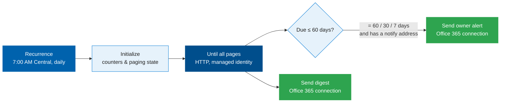

Once a day the Logic App pages through every `servicePrincipal` in the tenant via Microsoft Graph, filters each app's `keyCredentials` down to certificates with `usage: Sign`, and computes days-left for each one. Anything due within 60 days goes into the daily digest; anything hitting exactly the 60-, 30-, or 7-day mark (and that has a `notificationEmailAddresses` entry) also triggers an immediate, per-app alert to that address.

## What you need

- Microsoft Entra ID, with rights to create an Azure resource and grant admin consent for a Microsoft Graph application permission.
- An Azure subscription where you can create a resource group.
- A user who can sign in to authorize the Office 365 connection. That user sends the digest and alerts.
- The Azure CLI, signed in to the tenant — needed for one step (granting the managed identity its Graph permission), even though the rest of this build is pure clicking.

Read [Designer gotchas](#designer-gotchas) before you start. It will save you a failed test run.

## Build it step by step

### Part 1 — Create the Logic App and the trigger

**1. Create the Logic App resource.** Portal &gt; **Create a resource** &gt; **Logic App (Consumption)**. Pick the subscription and resource group, name it, choose a region, and leave **Workflow Type** as **Stateful**.

<p align="center">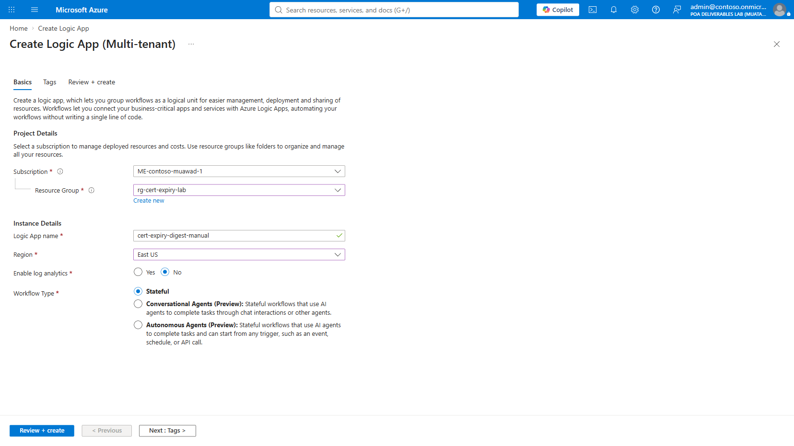</p>

**2. Wait for the deployment to finish**, then select **Go to resource**. This creates an empty Logic App with no trigger and no actions yet.

<p align="center">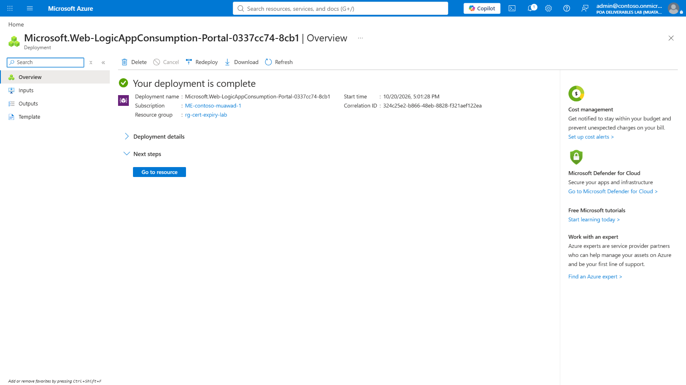</p>

**3. Add the trigger.** Open the designer and add a **Recurrence** trigger: Interval `1`, Frequency `Day`, time zone to match your business hours, **At these hours** `7`, **At these minutes** `0`.

<p align="center">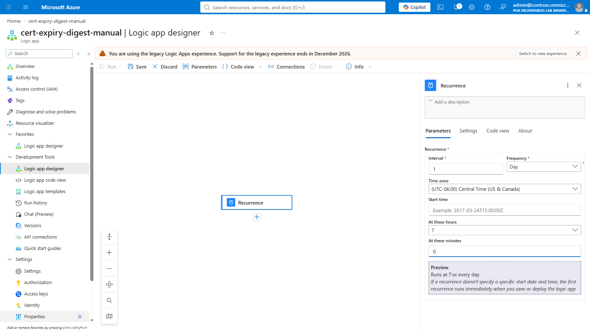</p>

### Part 2 — The four state variables

Add four **Initialize variable** actions in sequence, directly under the trigger:

**4. `nextUrl`** (String) — seeds the Microsoft Graph paging loop. Value:
```
https://graph.microsoft.com/v1.0/servicePrincipals?$select=id,appId,displayName,preferredSingleSignOnMode,notificationEmailAddresses,keyCredentials&$top=999
```

<p align="center">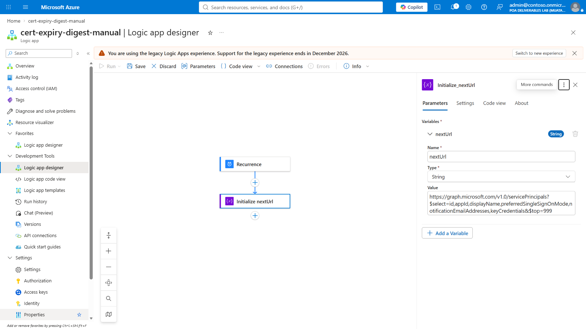</p>

**5. `csvRows`** (String) — the CSV inventory, seeded with just the header row:
```
AppName,AppId,SsoMode,CertExpiresUTC,DaysLeft,NotificationAddresses
```

<p align="center">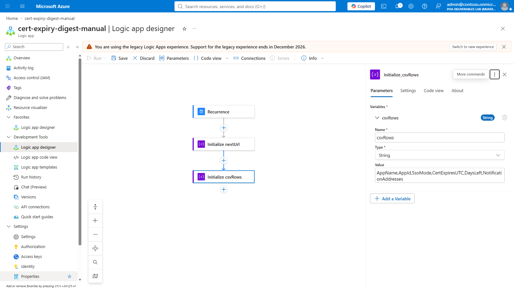</p>

**6. `alertRows`** (String) — the HTML table body for the digest email. Leave the value empty; `Append_alert` fills it in later.

<p align="center">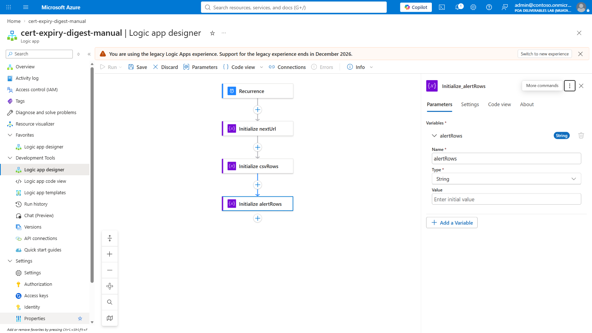</p>

**7. `alertCount`** (Integer) — counts how many certificates are due. Initial value `0`.

<p align="center">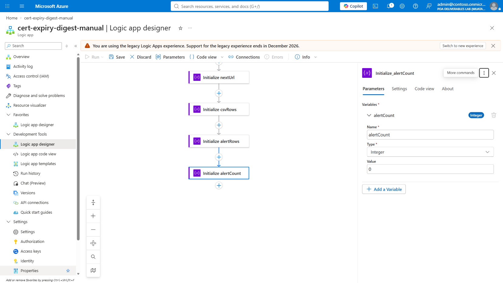</p>

### Part 3 — The paging loop

**8. Add an Until loop**, named `Until_all_pages`. Its condition is a single string in the **Loop until** box:
```
@empty(variables('nextUrl'))
```
Under **Advanced parameters**, set **Count** `100` and **Timeout** `PT1H` (one page per iteration, a safety ceiling of 100 pages, one hour to finish).

<p align="center">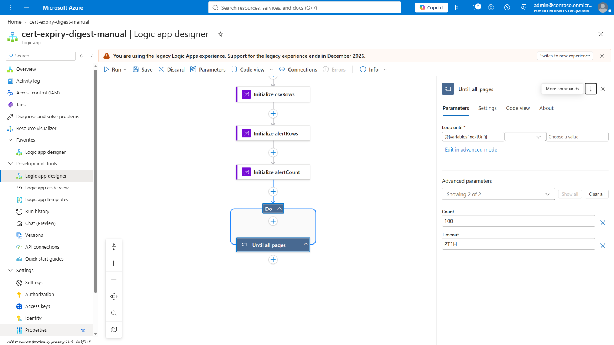</p>

**9. Inside the loop, add an HTTP action** named `Get_page`. Method `GET`, URI `@{variables('nextUrl')}`, Authentication type **Managed identity**, Managed identity **System-assigned**, Audience `https://graph.microsoft.com`. This is the one field in the whole build where `@{...}` (curly braces) is correct — the URI is genuinely a string.

<p align="center">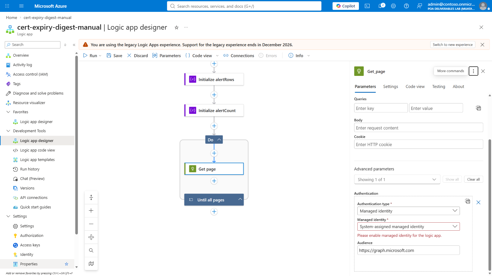</p>

> [!NOTE]
> **Two things this action depends on, neither of which happens in the designer:**
>
> **Turn on the managed identity.** A new Consumption Logic App doesn't have it enabled by default. Before picking **Managed identity** as the authentication type above, go to **Settings &gt; Identity**, set **System assigned &gt; Status** to **On**, and select **Save**. An **Object (principal) ID** appears once it's on — you'll need it next.
>
> **Grant that identity `Application.Read.All` on Microsoft Graph.** There's no "API permissions" button for a managed identity, so this is the one step in the whole build that isn't a click — it's three Azure CLI lookups and a Graph REST call:
> ```powershell
> $mi = az resource show -g <resource-group> -n <logic-app-name> `
>   --resource-type Microsoft.Logic/workflows --query identity.principalId -o tsv
> $graph = az ad sp show --id 00000003-0000-0000-c000-000000000000 --query id -o tsv
> $role = az ad sp show --id 00000003-0000-0000-c000-000000000000 `
>   --query "appRoles[?value=='Application.Read.All'].id | [0]" -o tsv
> ```
> Save `{ "principalId": "<mi>", "resourceId": "<graph>", "appRoleId": "<role>" }` as `role-body.json`, then:
> ```powershell
> az rest --method post `
>   --url "https://graph.microsoft.com/v1.0/servicePrincipals/$mi/appRoleAssignments" `
>   --headers "Content-Type=application/json" --body "@role-body.json"
> ```
> You can confirm it landed in the Entra admin center: **Enterprise applications** (switch **Application type** to include managed identities if the search comes up empty) &gt; find the Logic App by name &gt; **Permissions** — Microsoft Graph should show `Application.Read.All`, type Application, granted by Admin consent.
>
> **Wait 15–30 minutes before your first test run.** A run that starts too soon can get `403 Forbidden` / `Authorization_RequestDenied` on `Get_page` — sometimes after several pages have already succeeded — because its token was issued before the grant finished propagating. This happened while building this sample: a run at minute 6 after granting failed; a run at minute 21 succeeded. See [Troubleshooting](#troubleshooting).

**10. Add a Set variable action** named `Set_nextUrl`, right after `Get_page`, that advances the paging cursor to the next page (or empties it on the last page):
```
@{coalesce(body('Get_page')?['@odata.nextLink'], '')}
```

<p align="center">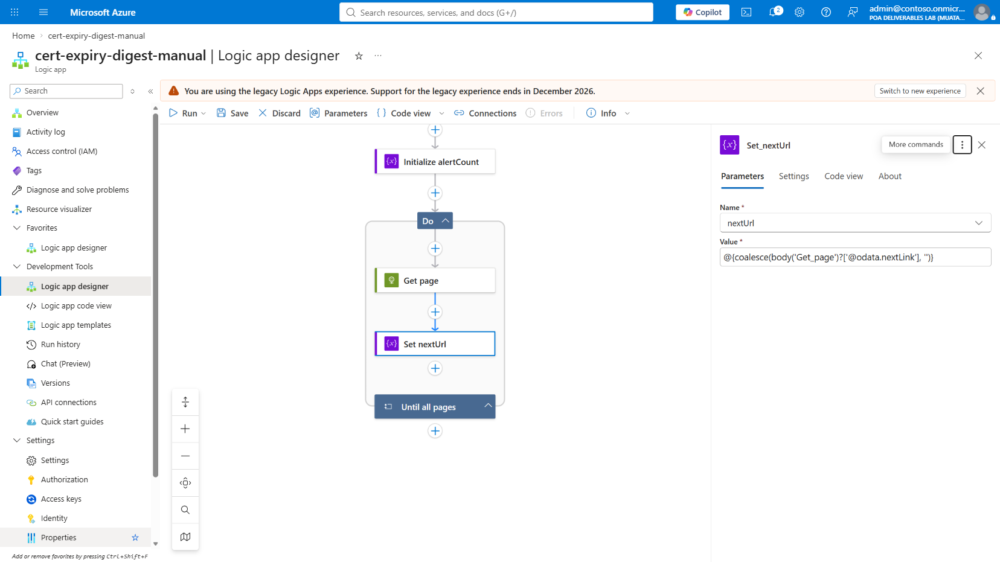</p>

### Part 4 — Per-application processing

**11. Add a For each loop** named `For_each_app`, right after `Set_nextUrl`, still inside the Until loop. **Select an output from previous steps**: the `value` array from `Get_page`'s response body. In **Settings**, turn concurrency control **On** and set **Degree of parallelism** to `1` — Microsoft Graph paging state (`nextUrl`) is shared across iterations, so apps must be processed one at a time, not in parallel.

<p align="center">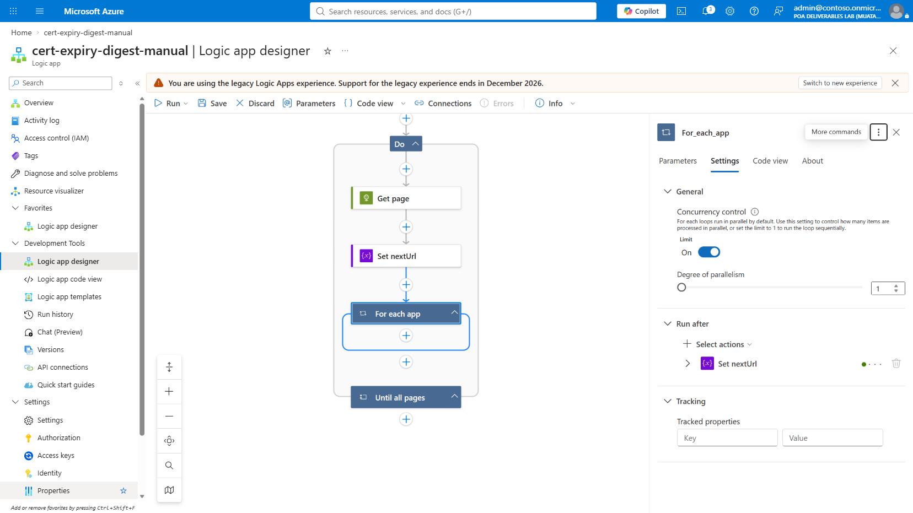</p>

**12. Inside `For_each_app`, add a Filter array action** named `Filter_sign_certs`. **From**: the current app's `keyCredentials` (with a `coalesce(...)` fallback to an empty array for apps with none). **Filter query**: `item()?['usage']` **is equal to** `Sign` — this keeps only certificates used for SAML/WS-Fed token signing, not encryption certificates.

<p align="center">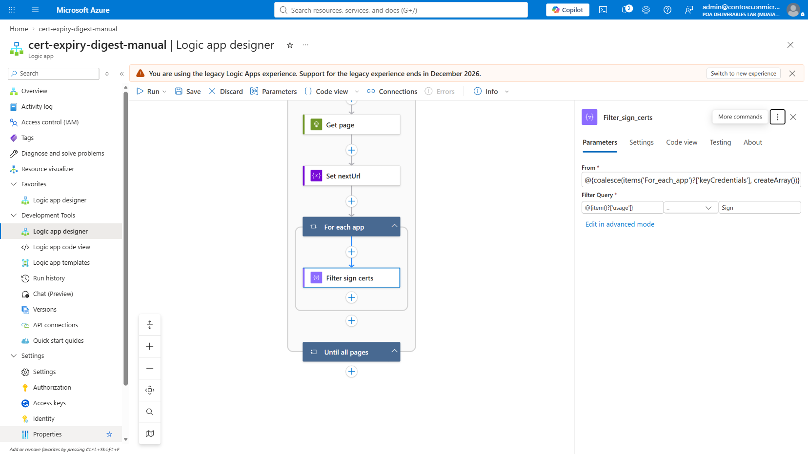</p>

**13. Add a second, nested For each loop** named `For_each_cert`, right after the filter, iterating over `Filter_sign_certs`' output. Leave concurrency at its default (parallel) here — each certificate's math is independent.

<p align="center">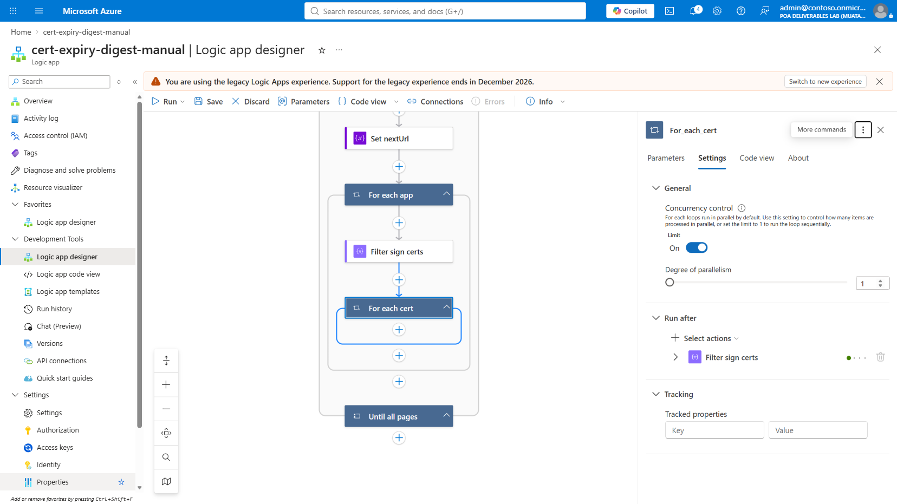</p>

### Part 5 — Per-certificate math (the Compose chain)

All six of the following are **Compose** actions, added one after another inside `For_each_cert`. Each reads outputs from the ones before it.

**14. `Compose_endDay`** — the certificate's expiry date, truncated to midnight UTC:
```
@concat(formatDateTime(items('For_each_cert')?['endDateTime'], 'yyyy-MM-dd'), 'T00:00:00Z')
```

<p align="center">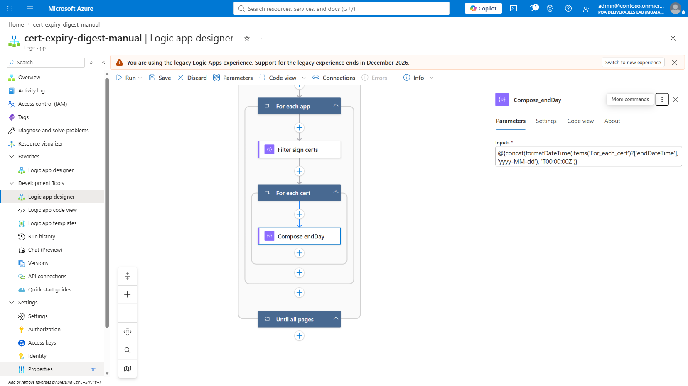</p>

**15. `Compose_today`** and **`Compose_days`** — `Compose_today` captures `@utcNow()` truncated the same way; `Compose_days` does the actual day-count math:
```
@div(sub(ticks(outputs('Compose_endDay')), ticks(outputs('Compose_today'))), 864000000000)
```
This must produce a real **Integer**, not a string — see [bug #4](#designer-gotchas-read-this-before-you-start) below.

<p align="center">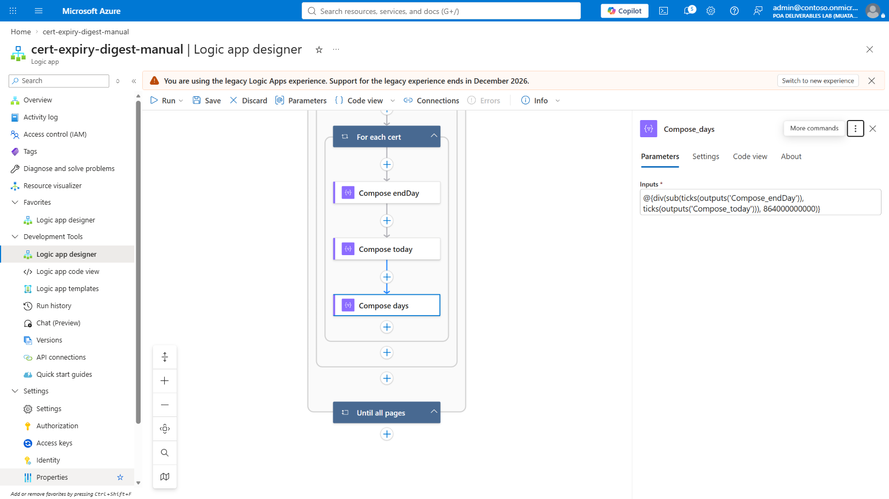</p>

**16. `Compose_notify`** and **`Compose_severity`** — `Compose_notify` joins the app's `notificationEmailAddresses` array into a semicolon-separated string; `Compose_severity` buckets the day-count into a label:
```
@if(lessOrEquals(outputs('Compose_days'), 7), '🔴 Critical', if(lessOrEquals(outputs('Compose_days'), 30), '🟠 Warning', '🔵 Notice'))
```

<p align="center">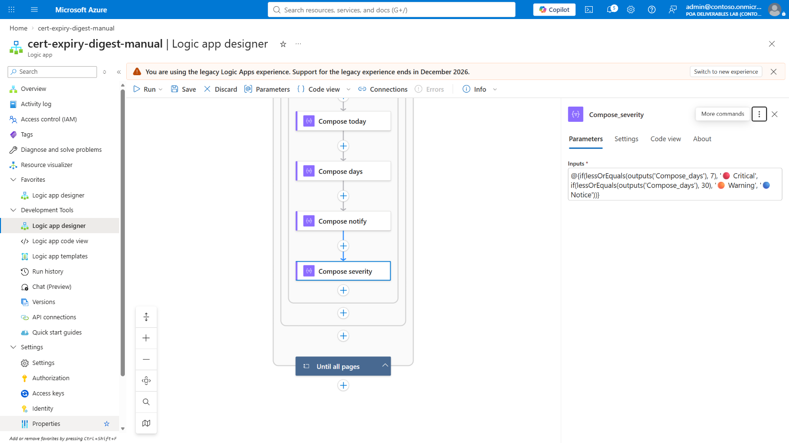</p>

**(`Compose_rowcolor`** follows the same pattern as `Compose_severity`, mapping days-left to a hex background color for the email table row — not separately screenshotted, but visible in later steps.)

**17. Add an Append to string variable action** named `Append_csv`, appending one line to `csvRows` for **every** certificate — due soon or not — so the attached inventory is complete:
```
"@{items('For_each_app')?['displayName']}",@{items('For_each_app')?['appId']},@{items('For_each_app')?['preferredSingleSignOnMode']},@{items('For_each_cert')?['endDateTime']},@{outputs('Compose_days')},@{outputs('Compose_notify')}
```

<p align="center">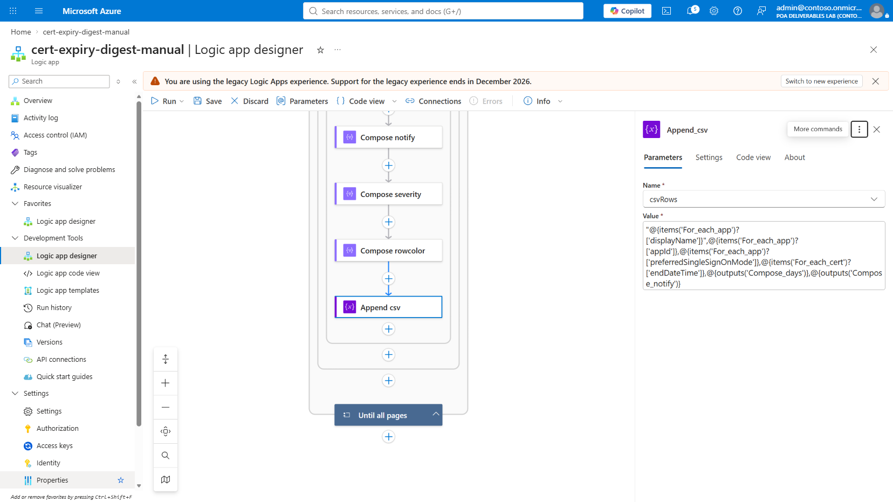</p>

### Part 6 — Due-date and owner-alert conditions

**18. Add a Condition action** named `Check_due`, right after `Append_csv`. Left value `outputs('Compose_days')`, operator **is less than or equal to**, right value `60`.

<p align="center">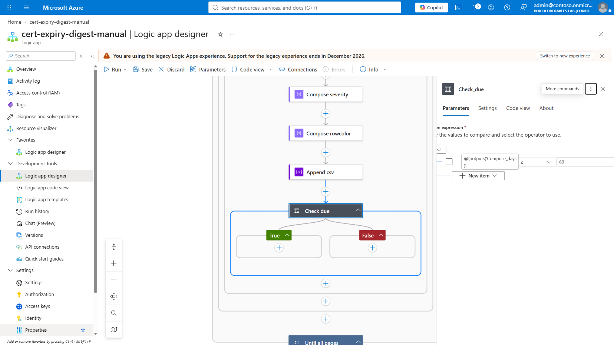</p>

**19. In the True branch, add `Append_alert`** (Append to string variable, appends one color-coded `<tr>` to `alertRows`) **then `Increment_alertCount`** (adds `1` to `alertCount`).

<p align="center">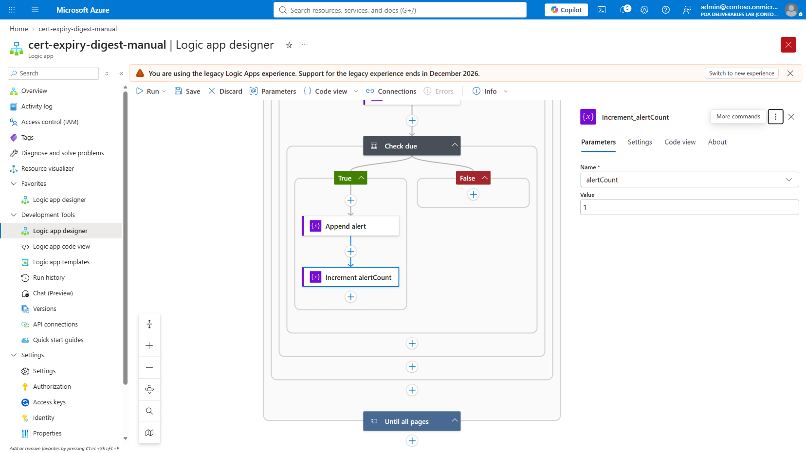</p>

**20. After `Check_due` (as a sibling, not nested inside it), add a second Condition action** named `Check_owner_alert`. Its condition checks the app actually has a notify address: `outputs('Compose_notify')` **is not equal to** an empty string.

<p align="center">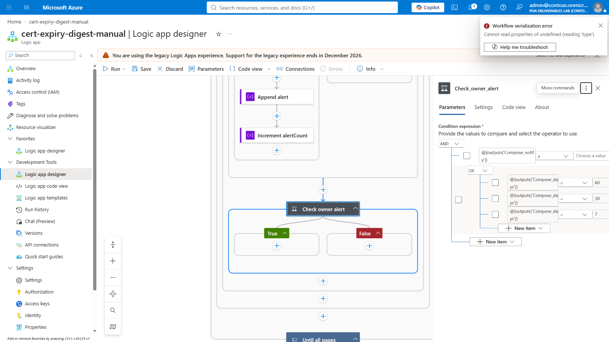</p>

> The toast in that screenshot — **"Workflow serialization error: Cannot read properties of undefined (reading 'type')"** — is the designer bug from [Designer gotchas](#designer-gotchas-read-this-before-you-start) happening live, the first of three times it showed up in this build. It doesn't block you from continuing to add actions, but it means the field you just edited didn't save correctly and needs the fix described below before the workflow will run.

**21. Inside `Check_owner_alert`'s True branch, add a nested Condition** named `Check_alert_threshold`: `outputs('Compose_days')` **equals** `60`, **OR** equals `30`, **OR** equals `7`. This fires the owner alert only at the exact threshold crossing, not on every day under it.

<p align="center">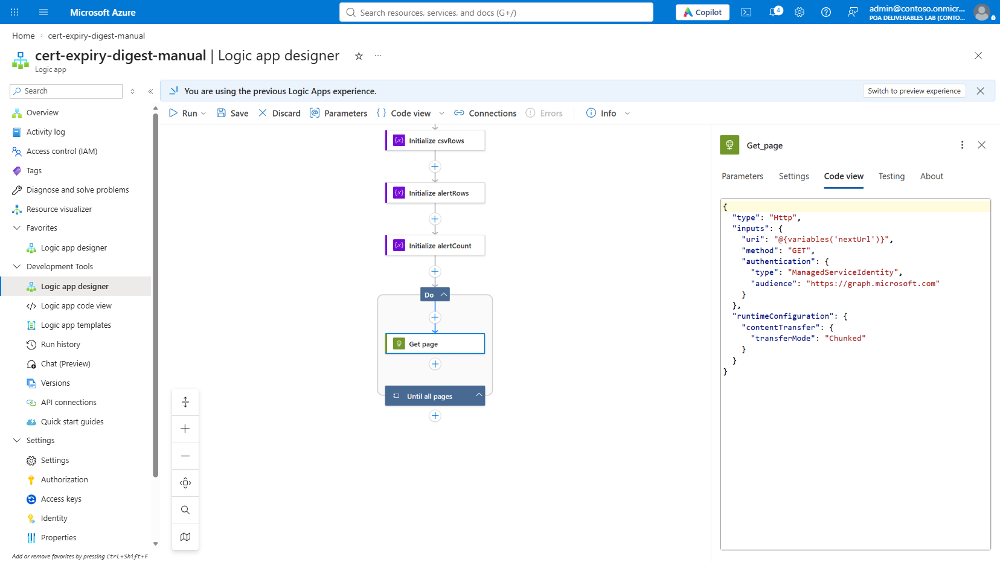</p>

**22. In `Check_alert_threshold`'s True branch, add a Send an email (V2) action** (Office 365 Outlook connector) named `Send_owner_alert` — To `@{outputs('Compose_notify')}`, Importance `High`, Subject and HTML body referencing the app name and day-count.

<p align="center">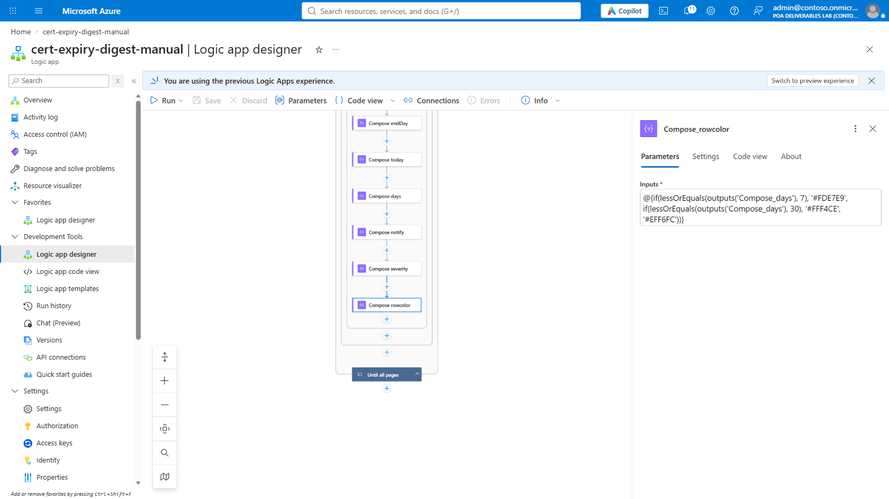</p>

> [!NOTE]
> This is the first action in the build that uses the Office 365 Outlook connector. The designer prompts you to sign in and create the connection right when you add it — do that now, authorizing as the account that should send the digest and alerts. Until it shows **Connected**, both `Send_owner_alert` and `Send_digest` (step 25) fail.

**23. Confirm `Check_due`'s full shape**: True branch running `Append_alert` → `Increment_alertCount`, False branch empty.

<p align="center">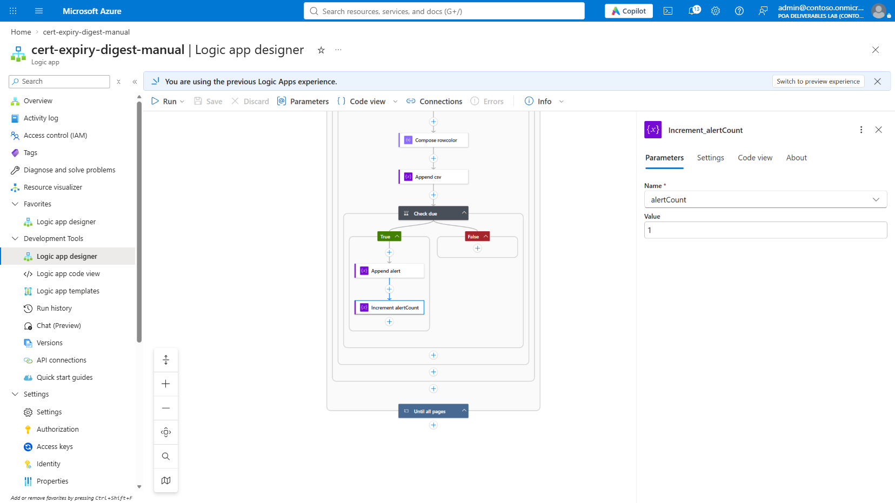</p>

### Part 7 — Send the digest

**24. Reconfirm `Send_owner_alert`'s placement** — nested three levels deep (`Check_owner_alert` → `Check_alert_threshold` → `Send_owner_alert`), after `Increment_alertCount` and `Check_owner_alert` in the outer sequence.

<p align="center">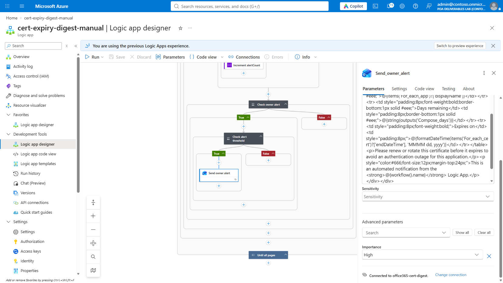</p>

**25. Outside and after `Until_all_pages`, add the final Send an email (V2)** action named `Send_digest` — the full daily summary with the `alertRows` table and the `csvRows` CSV as an attachment. Save, then zoom to fit for a final look at the whole workflow.

<p align="center">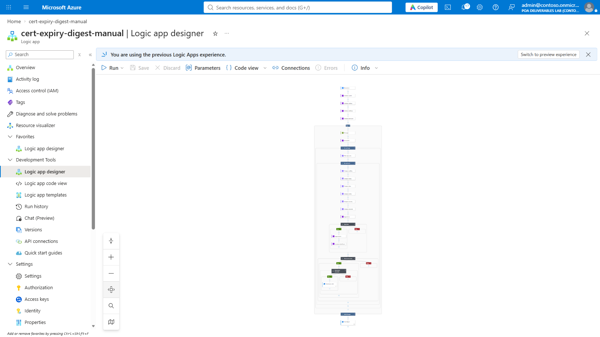</p>

That's all 23 actions. Next: read the section below *before* you hit **Run** for the first time.

## Designer gotchas

Building this workflow by hand in the (legacy) Consumption designer surfaces a **silent serialization bug class** that the ARM template in [QUICK-DEPLOY.md](QUICK-DEPLOY.md) never hits — because the template writes the workflow JSON directly, bypassing the UI code path that has the bug.

**The rule:** in Workflow Definition Language, a JSON string value that is *exactly* `@expression` (one leading `@`, no curly braces, nothing else in the string) gets replaced at runtime by the **real result** of that expression — an array stays an array, a number stays a number. Wrapping the same expression in `@{expression}` forces the result to be **stringified**, even if it was never meant to be a string. A field with **no leading `@` at all** isn't evaluated as an expression at all — it's a literal piece of text.

Both mistakes look identical while you're typing and **the designer doesn't flag most of them at save time.** They only surface later, as a run failure deep in the workflow, or — worse — as a logic bug that never throws an error at all. This build hit both forms:

| # | Action / field | What was typed (wrong) | What it must be | Symptom if left wrong |
|---|---|---|---|---|
| 1 | `For_each_app` → *Select an output from previous steps* | `@{body('Get_page')?['value']}` | `@body('Get_page')?['value']` | `ActionFailed`: *"the result of the evaluation of 'foreach' expression … is of type 'String'. The result must be a valid array."* |
| 2 | `Filter_sign_certs` → *From* | `@{coalesce(items('For_each_app')?['keyCredentials'], createArray())}` | `@coalesce(items('For_each_app')?['keyCredentials'], createArray())` | `BadRequest`: *"The 'from' property value … is of type 'String'. The value must be an array."* |
| 3 | `For_each_cert` → *Select an output from previous steps* | `@{body('Filter_sign_certs')}` | `@body('Filter_sign_certs')` | Same `ActionFailed` array-type error as #1, one loop level deeper |
| 4 | `Compose_days` → *Inputs* | `@{div(sub(ticks(outputs('Compose_endDay')), ticks(outputs('Compose_today'))), 864000000000)}` | `@div(sub(ticks(outputs('Compose_endDay')), ticks(outputs('Compose_today'))), 864000000000)` | Ran successfully itself, then broke every later step that compares it to a number: `InvalidTemplate`: *"'lessOrEquals' expects two parameter of matching types … 'String' and 'Integer'."* |
| 5 | `Check_due`, `Check_owner_alert`, `Check_alert_threshold` → condition row values | `outputs('Compose_days')` *(no `@` at all)* | `@outputs('Compose_days')` | `Check_due`: same `InvalidTemplate` type-mismatch, but only once the run reached it — 578 certificate iterations in. `Check_owner_alert` and `Check_alert_threshold` are worse: `equals()` tolerates the type mismatch instead of throwing, so the condition just silently evaluated **false for every certificate** and no owner alert was ever sent — with no error anywhere. |

Bug #5 is the one worth remembering most: **two of its three instances never produced a single error message.** The only way they were caught was by running the finished workflow end-to-end and checking that the email it sent actually matched the real certificates in the tenant, not by watching for red X's in the designer.

**How to fix an instance of this bug:** open the action, delete the token/chip in the affected field, then type the expression by hand with a single leading `@` and no curly braces, then press <kbd>Tab</kbd> to commit it before selecting **Save**. Re-check with **Code view** (or the action's REST `definition`) if you're not sure whether it landed as a bare `@expression` — the designer's visual token chip looks the same either way.

**The one place `@{...}` is correct in this workflow:** `Get_page`'s **URI** field (`@{variables('nextUrl')}`), and anywhere you're building literal text — HTML table rows, email Subject lines, the CSV line in `Append_csv`. Those fields are genuinely meant to hold a string, so forcing one is the right behavior, not a bug.

## Verifying the finished build

A clean run takes about 7–8 minutes end to end (paging through every service principal in the tenant, a few hundred certificates deep). Five test runs were needed to shake out the five bugs above, each one getting further than the last before hitting the next:

| Run | Outcome |
|---|---|
| 1 | Failed at `For_each_app` — bug #1 |
| 2 | Failed at `Filter_sign_certs` — bug #2 (bug #3 found and fixed proactively before re-running) |
| 3 | Failed at `Compose_severity` — bug #4 |
| 4 | Failed at `Check_due`, after reaching the last page of results — bug #5 (three instances) |
| 5 | **Succeeded.** All 24 actions green, 578 certificates checked across 6 pages, `Send_digest` delivered a 3-row digest that matched the real tenant data. |

If your run fails at an action not listed in the table above, it's most likely something covered in [Troubleshooting](#troubleshooting) below — permission propagation delay, an unauthorized connection, or expected business-data edge cases (an already-expired certificate, no certificates due, no notification address on file).

## Sample output

The screenshot below is the actual email this Logic App sent in the test tenant (recipient address redacted).

<p align="center"><br><sub><b>Daily digest email.</b> 🔴 Critical (≤ 7 days), 🟠 Warning (≤ 30 days), 🔵 Notice (≤ 60 days). A full inventory of every signing certificate — not just the ones expiring soon — is attached as <code>saml-inventory.csv</code>. On a day with nothing due, the body instead reads "✅ Good news — no SAML signing certificates are expiring within the next 60 days."</sub></p>

## Troubleshooting

| Symptom | Likely cause | Fix |
|---|---|---|
| `403 Forbidden` on **Get_page**, with `Authorization_RequestDenied: Insufficient privileges to complete the operation` — sometimes after several pages have already succeeded | The managed identity's token was issued before the `Application.Read.All` grant finished propagating through Microsoft Entra ID | Wait 15–30 minutes after granting the role, then run again. See the note under [step 9](#build-it-step-by-step). |
| **Send digest** or **Send owner alert** fails with `BadRequest`, or the connection shows **Error** | The Office 365 connection isn't authorized, or its sign-in expired | Open **Development Tools &gt; API connections**, select the Office 365 Outlook connection, **Edit API connection** &gt; **Authorize** &gt; sign in again &gt; **Save**. |
| A run fails with `ActionFailed`/`BadRequest` mentioning a type mismatch (`String` vs. array, integer, etc.), or an owner alert never fires even at exactly 60/30/7 days | A [Designer gotcha](#designer-gotchas) — a field got `@{...}`-wrapped or is missing its leading `@` | Open the action named in the error, re-check the field against the [Designer gotchas](#designer-gotchas) table, and retype it as a bare `@expression`. |
| The digest lists a certificate with a large negative **Days Left** | The certificate already expired and nothing removes old, already-expired signing certificates from the app | Expected — it's informational. Rotate or remove the stale certificate in **Enterprise applications &gt; this app &gt; Single sign-on**. |
| The digest body says "Good news — no certificates are expiring" | No signing certificate in the tenant is due within 60 days | Expected. The digest still sends, with the full CSV inventory attached. |
| No owner alert, even though a certificate is exactly 60/30/7 days out | The app has no `notificationEmailAddresses` configured | Expected by design — owner alerts only go to apps that have a notification address set. Everyone still sees it in the daily digest. |

## Limits

- **One sender.** The Office 365 connection sends as the user who authorized it. If that account is disabled or its sign-in changes, sending stops until someone signs in again.
- **Pagination takes minutes, not seconds.** The **Until all pages** loop calls Microsoft Graph once per page of service principals (999 per page) and can take several minutes in a tenant with many apps. This is normal — don't treat a long-running loop as a hang.
- **Owner alerts fire once per threshold crossing.** They trigger only when days-left equals exactly 60, 30, or 7 at the moment the daily job runs — not on every run while under that threshold.
- **SAML signing certificates only.** The query filters `keyCredentials` to `usage: Sign`. It doesn't cover app registration client-secret or client-certificate expiry.
- **No catch-up.** A failed run isn't retried for the day it missed. Watch the run history.

## Files

| File | What it is |
|---|---|
| `README.md` | This page |
| `docs/images/manual-build/` | 25 screenshots from the test tenant walking through every action (identifiers redacted) |
| `docs/images/` | Six more screenshots used in [QUICK-DEPLOY.md](QUICK-DEPLOY.md) (identifiers redacted) |
| [`QUICK-DEPLOY.md`](QUICK-DEPLOY.md) | The fast path — deploy the same Logic App from an ARM template instead of clicking through it |
| [`logic-app/cert-expiry-digest-la.json`](logic-app/cert-expiry-digest-la.json) | The ARM template itself. No secrets and no tenant-specific values — both are deployment parameters. |

## Test before production

Validate the permission grant, the paging query, the email content, the connection authorization, and the owner-alert threshold behavior in a non-production tenant before relying on this sample. Confirm the recipient parameter matches your intended environment.

## Prefer to deploy instead of clicking?

Once you understand how it's built, you don't have to build it this way every time. **[QUICK-DEPLOY.md](QUICK-DEPLOY.md)** deploys the exact same 23 actions from an ARM template in two commands — already correctly serialized, so none of the [Designer gotchas](#designer-gotchas) above apply to a template-deployed copy. They only matter again if you later open that copy in the designer and hand-edit an expression.

---

**Author**: Dr. Muataz Awad
