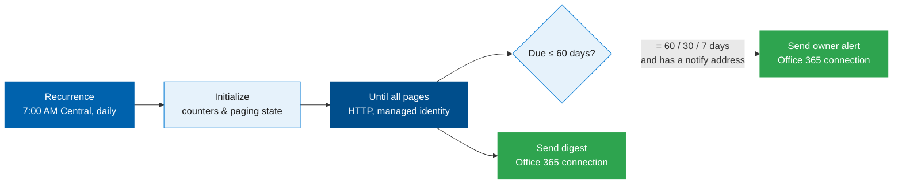
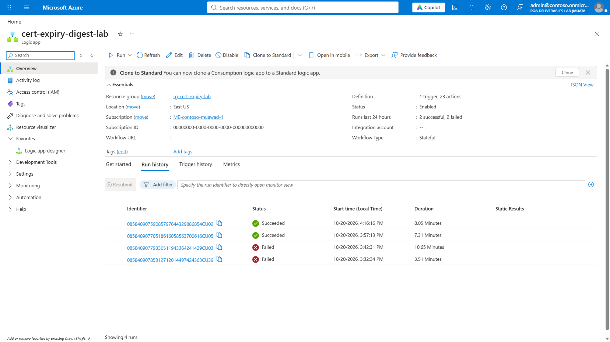
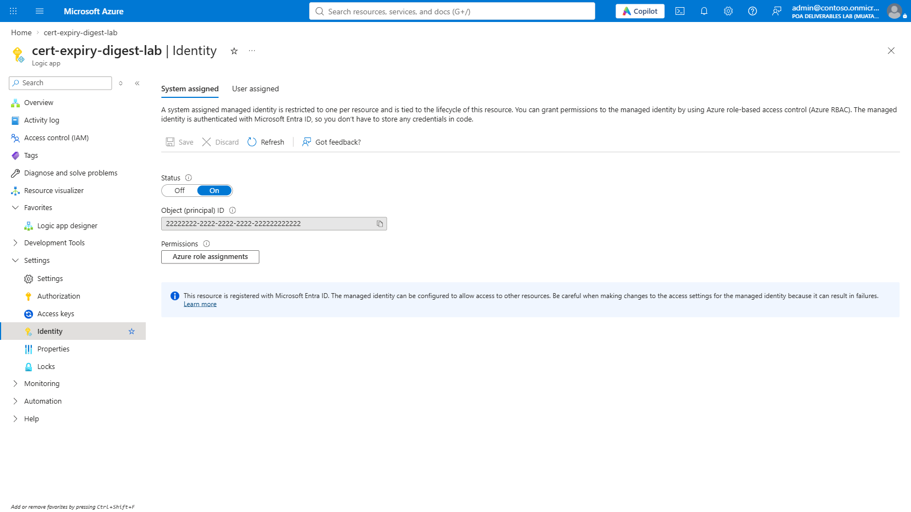
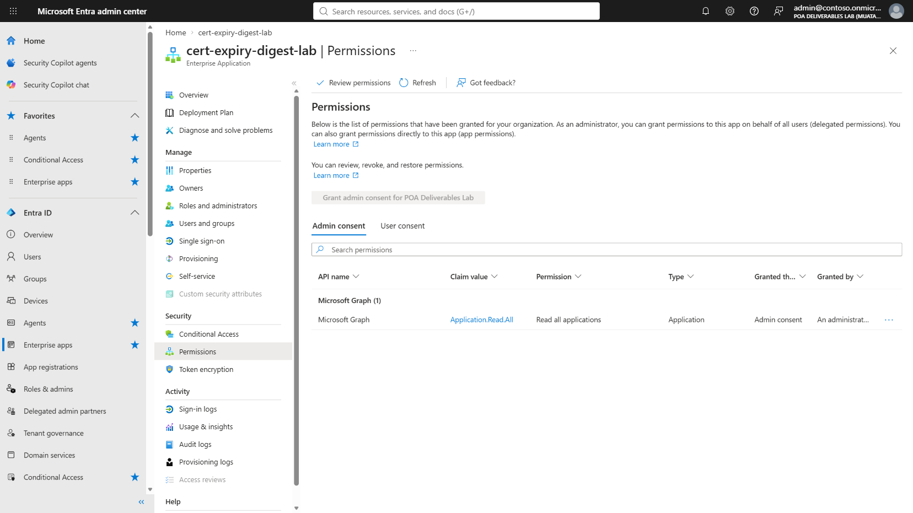
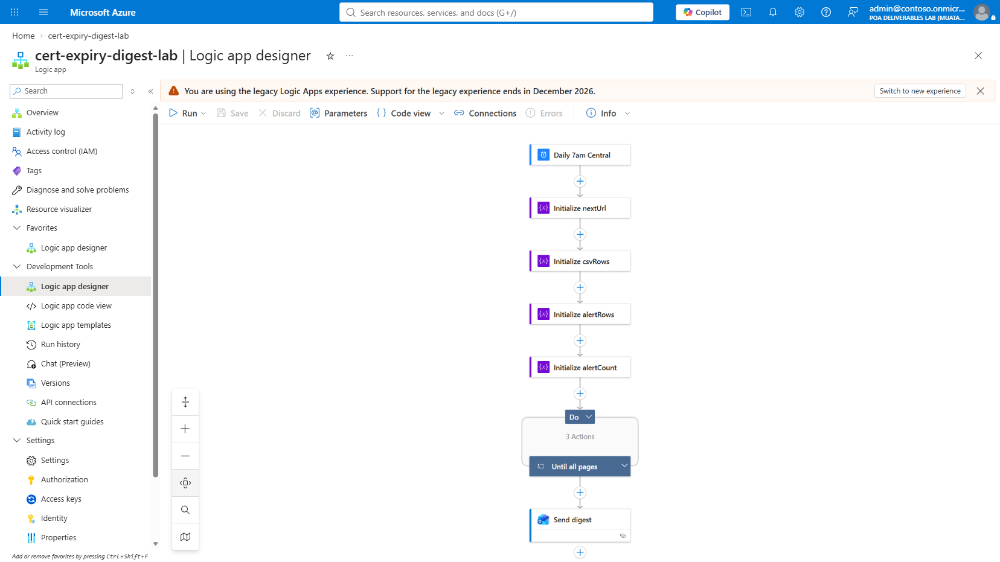
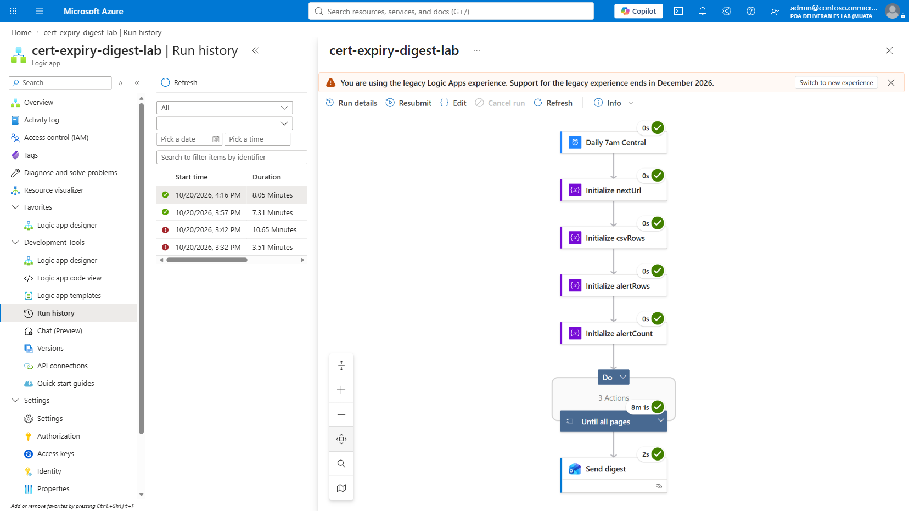
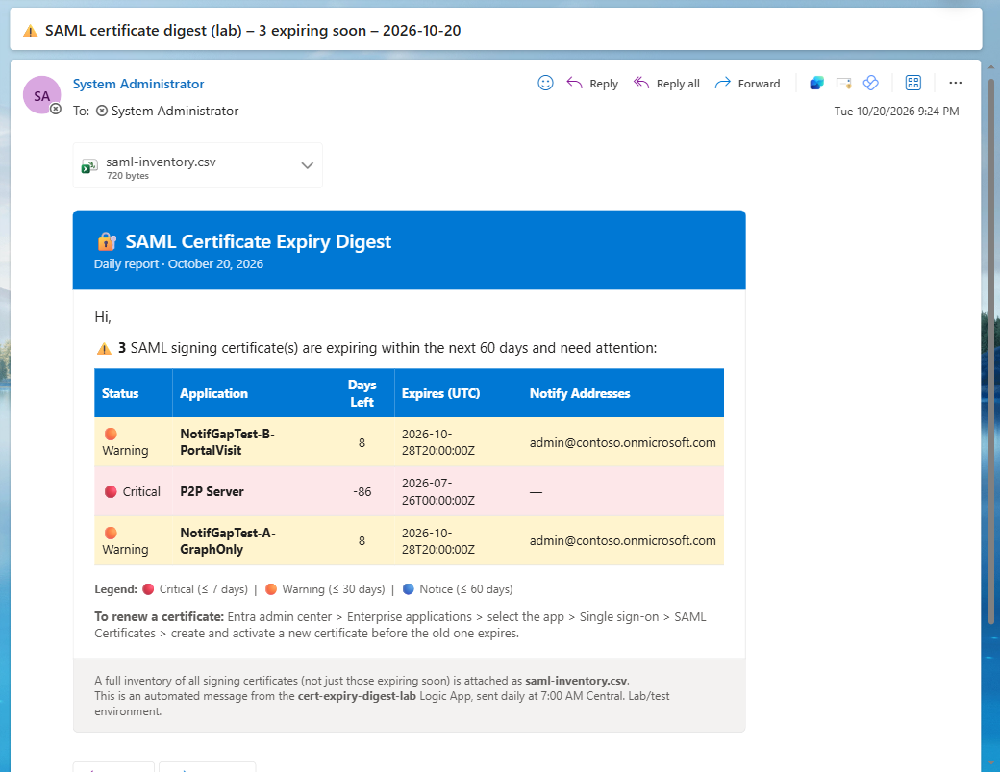

# Daily SAML Certificate Expiry Digest

[](https://learn.microsoft.com/azure/logic-apps/authenticate-with-managed-identity)
[](https://learn.microsoft.com/graph/api/serviceprincipal-list)
[](https://learn.microsoft.com/entra/identity-platform/howto-create-service-principal-portal)
[](../LICENSE)

Get a daily email that lists every SAML signing certificate expiring within 60 days, color-coded by urgency, plus an immediate alert at the 60/30/7-day marks for apps that have a notification address configured. The Logic App signs in to Microsoft Graph as its own **managed identity** — there's no client secret to store or rotate.

> [!IMPORTANT]
> This is a community sample, provided as-is. It isn't a supported Microsoft product. Test it in a lab tenant first. Tenant IDs, subscription IDs, and the tenant domain in every screenshot below have been replaced with placeholders; everything else (steps, errors, layout) is real.

## Contents

- [How it works](#how-it-works)
- [What you need](#what-you-need)
- [Step by step](#step-by-step)
- [Sample output](#sample-output)
- [Troubleshooting](#troubleshooting)
- [Limits](#limits)
- [Files](#files)
- [Test before production](#test-before-production)

## How it works



Once a day the Logic App pages through every `servicePrincipal` in the tenant via Microsoft Graph, filters each app's `keyCredentials` down to certificates with `usage: Sign`, and computes days-left for each one. Anything due within 60 days goes into the daily digest; anything hitting exactly the 60-, 30-, or 7-day mark (and that has a `notificationEmailAddresses` entry) also triggers an immediate, per-app alert to that address.

## What you need

- Microsoft Entra ID, with rights to create an Azure resource and grant admin consent for a Microsoft Graph application permission.
- An Azure subscription where you can create a resource group.
- A user who can sign in to authorize the Office 365 connection. That user sends the digest and alerts.
- The Azure CLI, signed in to the tenant.

## Step by step

### Step 1. Deploy the template

The template [`logic-app/cert-expiry-digest-la.json`](logic-app/cert-expiry-digest-la.json) creates the Logic App with a system-assigned managed identity, the daily trigger at 7:00 AM Central, the Microsoft Graph paging loop, and the Office 365 connection (unauthorized until [Step 6](#step-6-authorize-the-office-365-connection)).

```powershell
az group create --name <resource-group> --location <region>
az deployment group create --resource-group <resource-group> `
  --template-file logic-app/cert-expiry-digest-la.json `
  --parameters digestRecipient=<recipient-address>
```

When the deployment finishes, the resource group lists the Logic App and the connection as **Succeeded**.

### Step 2. Check the Logic App

Open the Logic App's **Overview**. **Status** should read **Enabled**, and **Definition** should read **1 trigger, 23 actions**.

<p align="center"><br><sub><b>Overview.</b> Essentials shows the resource group, location, and run history. This tenant had already run the deployment twice while a permission grant propagated (see <a href="#troubleshooting">Troubleshooting</a>) — that's why two early runs show Failed.</sub></p>

### Step 3. Confirm the managed identity

Open **Settings &gt; Identity**. **Status** should already read **On** — the template enables it at deployment time — and an **Object (principal) ID** is listed.

<p align="center"><br><sub><b>Settings &gt; Identity.</b> Copy the Object (principal) ID; you'll use it in the next step.</sub></p>

### Step 4. Grant the managed identity `Application.Read.All`

The Logic App calls Microsoft Graph as itself, so there's no client secret to create. Find the identity and the Microsoft Graph app role, then assign the role with admin consent:

```powershell
$mi = az resource show -g <resource-group> -n <logic-app-name> `
  --resource-type Microsoft.Logic/workflows --query identity.principalId -o tsv
$graph = az ad sp show --id 00000003-0000-0000-c000-000000000000 --query id -o tsv
$role = az ad sp show --id 00000003-0000-0000-c000-000000000000 `
  --query "appRoles[?value=='Application.Read.All'].id | [0]" -o tsv
```

Save this as `role-body.json`, with the three values above in place of the placeholders:

```json
{ "principalId": "<mi>", "resourceId": "<graph>", "appRoleId": "<role>" }
```

Then post it:

```powershell
az rest --method post `
  --url "https://graph.microsoft.com/v1.0/servicePrincipals/$mi/appRoleAssignments" `
  --headers "Content-Type=application/json" --body "@role-body.json"
```

> [!NOTE]
> Wait 15–30 minutes before the first run. A run that starts too soon can get `403 Forbidden` / `Authorization_RequestDenied` partway through, because its token was issued before the grant finished propagating. See [Troubleshooting](#troubleshooting) — this happened in the tenant used for these screenshots.

### Step 5. Confirm the permission grant

In the Entra admin center, open **Enterprise applications**, find the Logic App by name (switch **Application type** to include managed identities if the search comes up empty), then open **Permissions**.

<p align="center"><br><sub><b>Enterprise applications &gt; this app &gt; Permissions.</b> Microsoft Graph shows <code>Application.Read.All</code> (Read all applications), type Application, granted by Admin consent.</sub></p>

### Step 6. Authorize the Office 365 connection

1. Open **Development Tools &gt; API connections**, and select the Office 365 Outlook connection the template created.
2. Select **Edit API connection**, then **Authorize**. Sign in as the account that sends the digest.
3. Select **Save**. The status should read **Connected**.

Until this step is done, **Send digest** and **Send owner alert** fail, and nothing is sent.

### Step 7. Review the designer

Open the Logic App designer. The top level is five steps: the daily trigger, four **Initialize** variables, the **Until all pages** loop (collapsed — it contains the Graph paging and the per-app, per-certificate checks), and **Send digest**.

<p align="center"><br><sub><b>Logic app designer</b> (zoomed to fit). The loop's 3 inner actions (Graph paging, per-app certificate check, per-cert alerting) stay collapsed at this level.</sub></p>

### Step 8. Run it and check the history

Select **Run** (or wait for the 7:00 AM trigger). Pay attention to the first run after Step 4 — see the Note above. Then open **Run history**.

<p align="center"><br><sub><b>Run history.</b> A successful run shows a green check on every step, including the <b>Until all pages</b> loop (it can take several minutes — it pages through every service principal in the tenant) and <b>Send digest</b>.</sub></p>

## Sample output

The screenshot below is the actual email this Logic App sent in the test tenant (recipient address redacted).

<p align="center"><br><sub><b>Daily digest email.</b> 🔴 Critical (≤ 7 days), 🟠 Warning (≤ 30 days), 🔵 Notice (≤ 60 days). A full inventory of every signing certificate — not just the ones expiring soon — is attached as <code>saml-inventory.csv</code>. On a day with nothing due, the body instead reads "✅ Good news — no SAML signing certificates are expiring within the next 60 days."</sub></p>

## Troubleshooting

| Symptom | Likely cause | Fix |
|---|---|---|
| `403 Forbidden` on **Get_page**, with `Authorization_RequestDenied: Insufficient privileges to complete the operation` — sometimes after several pages have already succeeded | The managed identity's token was issued before the `Application.Read.All` grant from Step 4 finished propagating through Microsoft Entra ID | Wait 15–30 minutes after granting the role, then run again. This is exactly what happened while building this sample: a run at minute 6 after granting failed; a run at minute 21 succeeded. |
| **Send digest** or **Send owner alert** fails with `BadRequest`, or the connection shows **Error** | The Office 365 connection isn't authorized, or its sign-in expired | Repeat [Step 6](#step-6-authorize-the-office-365-connection) on the connection the Send steps use. |
| The digest lists a certificate with a large negative **Days Left** | The certificate already expired and nothing removes old, already-expired signing certificates from the app | Expected — it's informational. Rotate or remove the stale certificate in **Enterprise applications &gt; this app &gt; Single sign-on**. |
| The digest body says "Good news — no certificates are expiring" | No signing certificate in the tenant is due within 60 days | Expected. The digest still sends, with the full CSV inventory attached. |
| No owner alert, even though a certificate is exactly 60/30/7 days out | The app has no `notificationEmailAddresses` configured | Expected by design — owner alerts only go to apps that have a notification address set. Everyone still sees it in the daily digest. |

## Limits

- **One sender.** The Office 365 connection sends as the user who authorized it. If that account is disabled or its sign-in changes, sending stops until someone signs in again.
- **Pagination takes minutes, not seconds.** The **Until all pages** loop calls Microsoft Graph once per page of service principals (999 per page) and can take several minutes in a tenant with many apps. This is normal — don't treat a long-running loop as a hang.
- **Owner alerts fire once per threshold crossing.** They trigger only when days-left equals exactly 60, 30, or 7 at the moment the daily job runs — not on every run while under that threshold.
- **SAML signing certificates only.** The query filters `keyCredentials` to `usage: Sign`. It doesn't cover app registration client-secret or client-certificate expiry.
- **No catch-up.** A failed run isn't retried for the day it missed. Watch the run history.

## Files

| File | What it is |
|---|---|
| `README.md` | This page |
| `docs/images/` | Six real screenshots from the test tenant (identifiers redacted) |
| `logic-app/cert-expiry-digest-la.json` | ARM template for the Logic App. It has no secrets and no tenant-specific values — both are deployment parameters. |

## Test before production

Validate the permission grant, the paging query, the email content, the connection authorization, and the owner-alert threshold behavior in a non-production tenant before relying on this sample. Confirm the recipient parameter matches your intended environment.

---

**Author**: Dr. Muataz Awad
